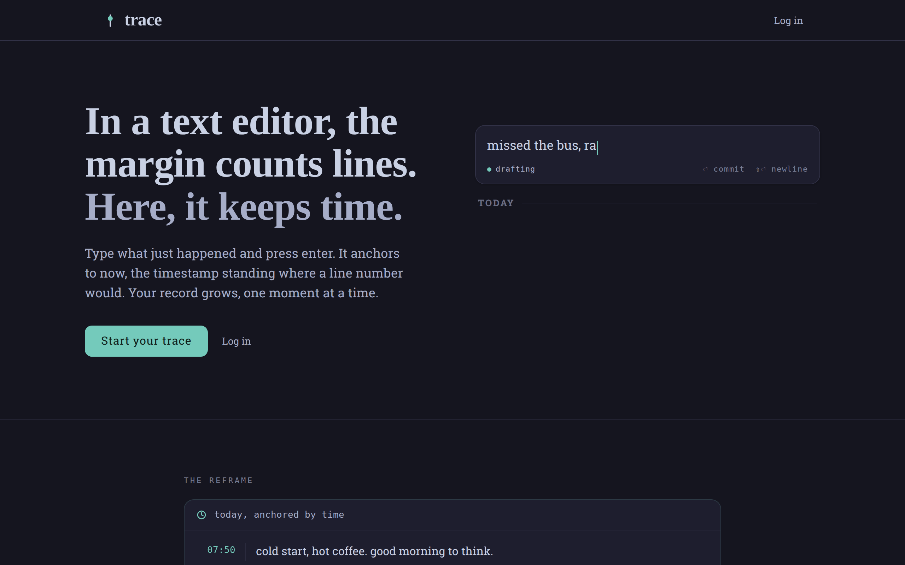

# Trace

A personal timeline where the unit of writing is a moment, not a line. You type
what just happened, press Enter, and it gets pinned to the time it happened.

**Live:** [trace.ahmdmshazly.me](https://trace.ahmdmshazly.me)



## Why I built it

Journaling apps ask you to sit down and write. I wanted something closer to a
logbook, you open it, write one line and close it. The rule I held the whole
project to was that capturing a moment has to cost almost nothing. Everything
else (search, tags, export) comes after that.

The second rule is that the data belongs to the user. Entries are stored flat and
time-keyed, and you can export everything as Markdown or JSON at any time.

## What it does

- **Capture.** Type and press Enter. The entry is saved with the current time.
  Shift+Enter adds a new line, and `#tags` are picked up inline.
- **Timeline.** Entries are grouped by day, newest first, and use keyset
  pagination so long histories stay fast.
- **Curation.** Edit an entry, backdate it, or delete it with undo. Deleted
  entries are kept, so you can restore them.
- **Search.** ⌘K searches your whole record on the server, and there is a tag
  index to jump between topics.
- **Export.** Download everything as Markdown or JSON.
- **Accounts.** Sign up, log in, reset a forgotten password by email, or delete
  your account with all its data. Light and dark themes are there as well.

## How it's built

| Layer | Choice |
|---|---|
| Client | React 18 + TypeScript, built with Vite |
| API | Express 4 + TypeScript (strict), zod validation at the edges |
| Data | MongoDB Atlas via Mongoose |
| Hosting | Vercel: the client as static files, the API as a serverless function on the same origin |
| Tests | Vitest, Supertest and mongodb-memory-server for the API; Playwright end to end |
| CI | GitHub Actions: lint, typecheck, tests and build for both packages |

A few things I spent real time on:

- **Per-user isolation.** Every entry query is scoped to the signed-in user in the
  service layer, and a separate isolation test suite tries to read and change
  another user's data and expects to fail.
- **Sessions that can actually be revoked.** Sessions live in httpOnly cookies.
  Each user has a session epoch, so resetting a password or deleting an account
  invalidates every token issued before it.
- **Rate limiting that works on serverless.** Auth endpoints are rate limited
  with a MongoDB-backed store, because an in-memory counter resets on every cold
  start and doesn't hold across instances.
- **Two timestamps.** `createdAt` records when you wrote an entry and never
  changes. `occurredAt` records when the thing happened, and you can edit it. All
  times are stored in UTC and shown in local time.
- **Backups I have tested.** A GitHub Actions job dumps the database to S3 every
  six hours using OIDC, so there are no long-lived AWS keys. The bucket
  replicates to a second region, and I ran a full restore onto a standby EC2
  host to make sure the dumps are usable.
- **Small dependency surface.** React is served from the same origin instead of
  a CDN, behind a Content Security Policy, with helmet on the API and passwords
  hashed with bcrypt.

## How I worked

I wrote the specs before the code. The project has a short
[constitution](docs/constitution.md) with the principles every decision gets
checked against, and each feature has its own folder under [`specs/`](specs/)
with a spec, a plan, a data model, an OpenAPI contract and a task list.

The [`docs/`](docs/) folder covers requirements, architecture (C4 diagrams
included), project planning, engineering practice, operations runbooks and the
design system. Decisions that are hard to undo later are written up as
[architecture decision records](docs/adr/).

## Project layout

```
.
├── frontend/   React client and the Trace design system
├── backend/    Express API, models, services and tests
├── api/        Vercel serverless entry for the API
├── specs/      Feature specs, plans, contracts and tasks (001-004)
├── docs/       Requirements, architecture, operations, design, ADRs
├── scripts/    Backup and restore scripts
└── .github/    CI and backup workflows
```

## Running it locally

You need Node 22 and a MongoDB instance (Docker works: `docker compose up -d`).

```bash
npm install            # root tooling
npm run install:all    # backend and frontend dependencies
cp backend/.env.example backend/.env   # then set JWT_SECRET
npm run dev            # API on :4000, web app on :5173
```

Tests:

```bash
cd backend && npm test        # unit, integration and isolation suites
cd frontend && npm run test:e2e
```

## Deploying

The repo deploys to Vercel as is. Set `MONGODB_URI`, `JWT_SECRET`,
`ALLOWED_ORIGINS`, `APP_ORIGIN` and `NODE_ENV=production` in the project
settings, then push to `main`. The full procedure, with rollback and the
post-deploy checklist, is in
[docs/05-operations/deployment.md](docs/05-operations/deployment.md).
