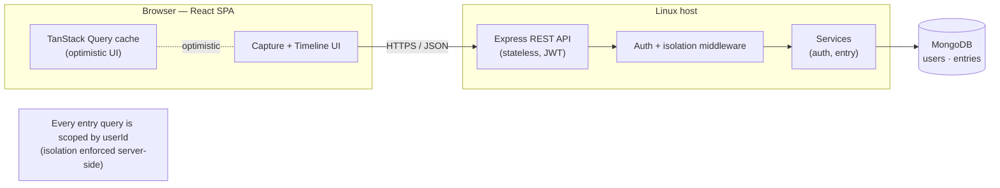
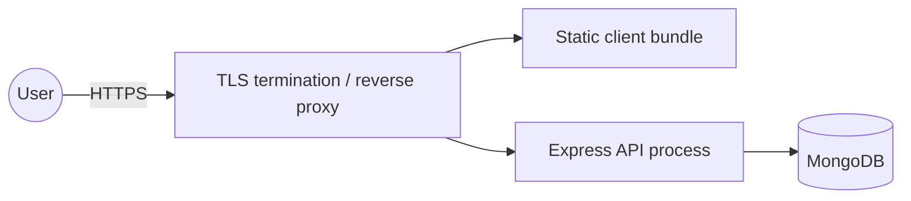

# Architecture Overview — Trace

**Status:** Baseline · **Last updated:** 2026-06-18 · **Audience:** engineering

The system-level view of Trace. Detailed views live in sibling documents:
[C4 model](./c4-model.md) · [data model](./data-model.md) · [API design](./api-design.md) ·
[security](./security.md) · [tech stack](./tech-stack.md). Decisions are recorded
as [ADRs](../adr/).

---

## 1. Architectural drivers

The architecture is shaped by these forces (from the [Constitution](../constitution.md) and [SRS](../01-requirements/srs.md)):

1. **Near-zero capture friction** → optimistic UI, minimal client round-trips on the hot path.
2. **Strict per-user isolation** → centralized, server-enforced `userId` scoping.
3. **Data ownership & portability** → flat, documented, export-ready schema.
4. **Hostable + scalable** → stateless API, config-driven deploy.
5. **Simplicity / YAGNI** → two services, no premature distribution.

## 2. Style

A conventional **two-tier web application** with a clear client/server split:

- **Client:** a React single-page application (the *capture surface*).
- **Server:** a stateless Express/Node REST API (the *system of record gateway*).
- **Datastore:** MongoDB (document store; the corpus lives here).

There is exactly one backend service in V1. We deliberately avoid microservices,
queues, and caches until a requirement demands them (Constitution VII).

## 3. Container view (high level)



## 4. Logical layers (server)

```
routes/        HTTP boundary — validation (zod), status codes, shapes
  ↓
middleware/    cross-cutting — auth (JWT→userId), requireUser, rate limit, errors
  ↓
services/      business logic — auth.service, entry.service (own the userId filter)
  ↓
models/        Mongoose schemas + indexes (User, Entry)
  ↓
MongoDB
```

- **Routes** never talk to the database directly; they call services.
- **Services** own the `userId` scoping — the single, auditable place isolation is enforced (research [R-03](../../specs/001-foundation-and-capture/research.md)).
- **Models** define schema, indexes, and invariants (immutable `createdAt`).

## 5. Logical layers (client)

```
pages/         route-level screens (Login, Register, Capture)
components/     CaptureInput, TimelineEntry, DayHeader, ...
api/           typed client + TanStack Query hooks (server state)
lib/           auth context, day-grouping, theme
```

The client holds **no authority** — every rule it appears to enforce (isolation,
immutability, validation) is also enforced server-side. The client's job is speed
and ergonomics (optimistic capture, focus management, day grouping).

## 6. Key runtime flows

- **Capture (hot path):** Enter → optimistic insert in the client → `POST /entries` → server stamps + persists → reconcile. Perceived latency < 100 ms because the UI does not wait for the round trip ([R-04](../../specs/001-foundation-and-capture/research.md)).
- **Timeline:** `GET /entries?cursor=…` → keyset pagination on `(occurredAt,_id)` → client groups by local day ([R-05](../../specs/001-foundation-and-capture/research.md), [R-06](../../specs/001-foundation-and-capture/research.md)).
- **Auth:** register/login → JWT issued → every subsequent request carries the bearer token → middleware resolves `userId`.

Full journeys: [flow diagrams](../diagrams/trace-diagrams.md).

## 7. Cross-cutting concerns

| Concern | Approach | Reference |
|---|---|---|
| AuthN | JWT bearer tokens, bcrypt password hashes | [ADR-0003](../adr/0003-jwt-authentication.md), [security](./security.md) |
| AuthZ / isolation | `userId` scoping in service layer + isolation test suite | [security](./security.md) |
| Validation | zod at the route boundary | [R-08](../../specs/001-foundation-and-capture/research.md) |
| Config & secrets | validated env module, fail-fast, nothing in source | [R-10](../../specs/001-foundation-and-capture/research.md), [environments](../04-engineering/environments.md) |
| Logging | structured logs, no entry content/secrets | [observability](../05-operations/observability.md) |
| Errors | central error handler, consistent error shape | [api-design](./api-design.md) |
| Time | store UTC, display/group local | [ADR-0005](../adr/0005-utc-storage-local-display.md) |

## 8. Deployment topology (V1)

A single API process and a static client bundle, both promoted from local to host
via configuration only. The API is stateless, so it can be redeployed or scaled
horizontally without sticky sessions. See [deployment](../05-operations/deployment.md).



## 9. Quality attribute tactics (summary)

| Attribute | Tactic |
|---|---|
| Performance | Optimistic UI; keyset pagination; compound index `{userId, occurredAt:-1, _id:-1}`. |
| Security | Centralized isolation; JWT + bcrypt; helmet/cors; rate limiting; input validation. |
| Reliability | Durable writes before commit confirmation; soft-delete only. |
| Operability | Health endpoint; structured logs; config-driven deploy. |
| Maintainability | Strict layer separation; documented OpenAPI contract; modular services. |

## 10. What we are explicitly NOT doing in V1

No microservices, no message queue, no separate cache tier, no offline/sync
engine, no read replicas. These are revisited only when a concrete requirement
(and an ADR) justifies the complexity.
