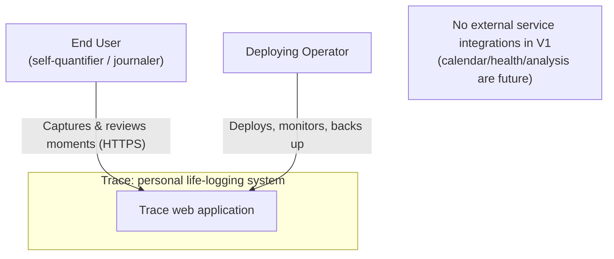
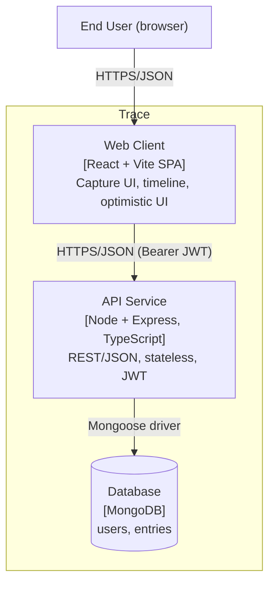
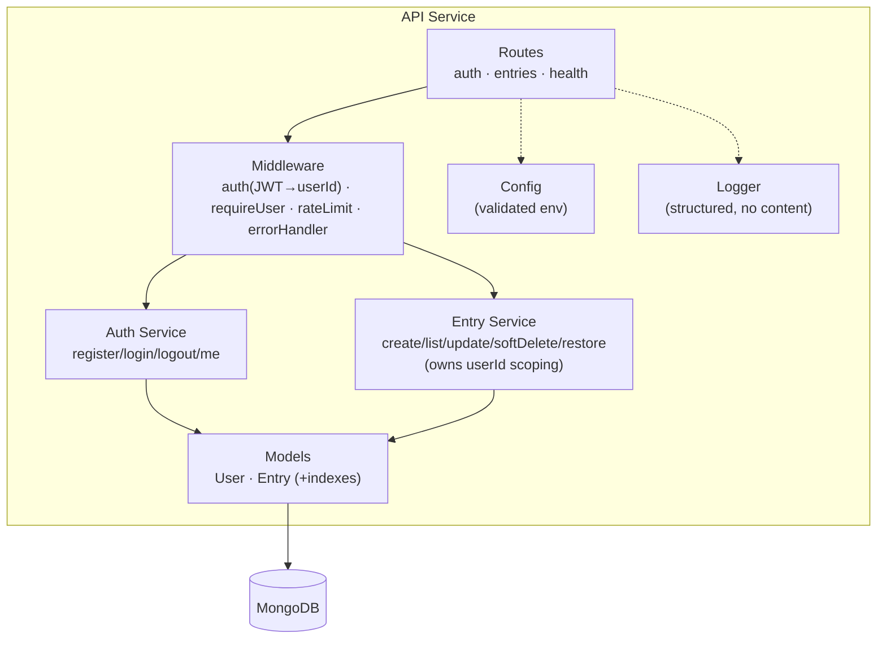
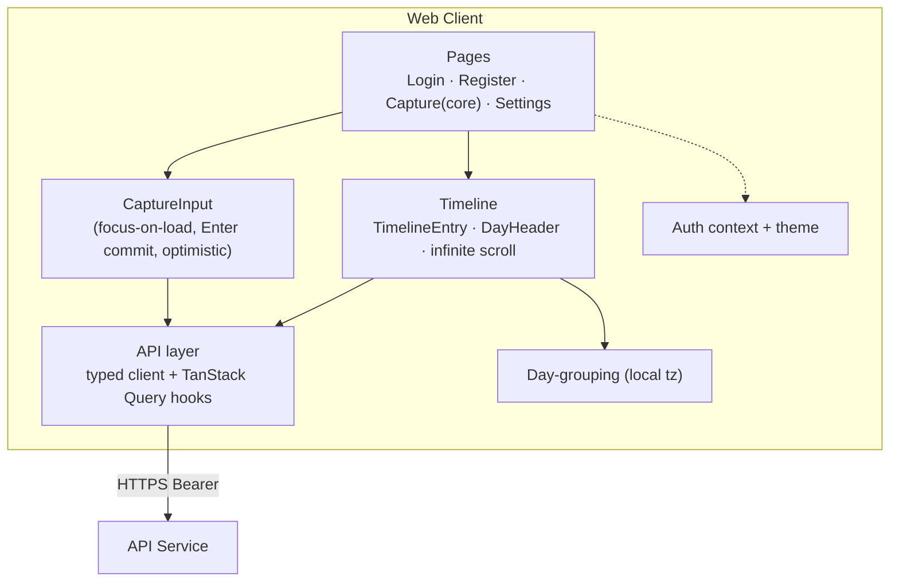

# C4 Model: Trace

**Status:** Baseline · **Last updated:** 2026-06-18

The [C4 model](https://c4model.com) describes the system at increasing zoom:
**Context → Container → Component**. Code-level (Level 4) is left to the source.
Diagrams are Mermaid so they render in GitHub/VS Code.

---

## Level 1: System Context

Who uses Trace and what it depends on.

**Notes:** V1 has **no** third-party integrations. Email delivery for password
reset (feature 004) will be the first external dependency.

## Level 2: Containers

The deployable/executable units.

| Container | Tech | Responsibility |
|---|---|---|
| Web Client | React 18 + Vite, TS | Capture surface, timeline, search/tag/export UI, optimistic UI, focus & day-grouping |
| API Service | Node 22 + Express, TS | AuthN/AuthZ, isolation, entry CRUD, pagination, export; the only writer to the DB |
| Database | MongoDB 7 | Persistent store of users and entries |

## Level 3: Components (API Service)

Inside the API container.

## Level 3: Components (Web Client)

Inside the client container.

---

## Mapping to requirements

| C4 element | Requirements |
|---|---|
| API Service · isolation middleware | FR-7.4, NFR-4.3 |
| API Service · Entry Service | FR-1.*, FR-2.*, FR-3.4 |
| Web Client · CaptureInput | FR-1.1, FR-1.3, FR-1.4; NFR-1.2, NFR-7.1 |
| Web Client · Timeline + grouping | FR-3.1, FR-3.2; NFR-1.4 |
| Database · indexes | NFR-1.3, NFR-10.2 |

See the full [traceability matrix](../01-requirements/traceability-matrix.md).
