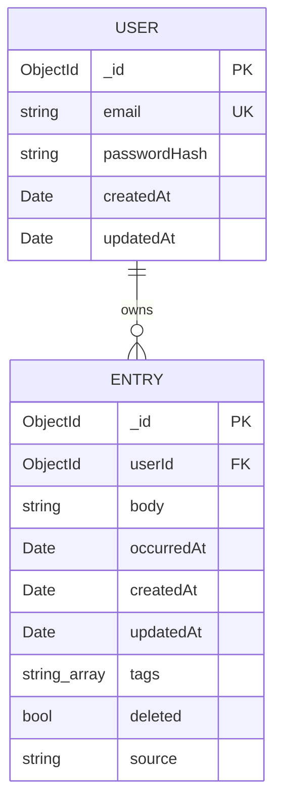

# Data Model — Trace (Canonical)

**Status:** Baseline · **Authoritative** · **Last updated:** 2026-06-18

This is the **canonical, project-wide** data model. Feature-scoped views (e.g.
[`specs/001-foundation-and-capture/data-model.md`](../../specs/001-foundation-and-capture/data-model.md))
must stay consistent with this document. Schema changes require an
[ADR](../adr/) and a migration note (Constitution II).

---

## Design principles

The Entry schema is intentionally **flat, user-scoped, time-keyed, and
tag-indexed** so the corpus is directly consumable by a future analysis layer
(an algorithm or analysis engine) without preprocessing. Two timestamps carry distinct meaning:

- **`occurredAt`** — when the moment *happened*. The **primary analysis axis**. Editable (backdating).
- **`createdAt`** — when the entry was *committed*. **Immutable**. The honest ledger of when you actually logged.

## Entities

### User

| Field | Type | Constraints | Notes |
|---|---|---|---|
| `_id` | ObjectId | PK | Unique user identifier |
| `email` | string | required · unique · lowercased | Login identifier |
| `passwordHash` | string | required | bcrypt salted hash; never plaintext/reversible (NFR-4.2) |
| `createdAt` | Date (UTC) | auto | Account creation |
| `updatedAt` | Date (UTC) | auto | Last account update |

- **Indexes:** unique on `email`.
- **Never serialized:** `passwordHash` is excluded from all API responses.

### Entry

| Field | Type | Constraints | Notes |
|---|---|---|---|
| `_id` | ObjectId | PK | Unique entry identifier |
| `userId` | ObjectId | required · FK→User · indexed | Owning user; every query filters on this (FR-7.4) |
| `body` | string | required · non-empty (trimmed) | Markdown-friendly plain text |
| `occurredAt` | Date (UTC) | required · indexed | When it happened — primary analysis axis; editable |
| `createdAt` | Date (UTC) | required · immutable | Commit instant; set once, never changes |
| `updatedAt` | Date (UTC) | auto | Refreshes on body/`occurredAt` change |
| `tags` | string[] | default `[]` · indexed (002) | Parsed from inline `#hashtags` (feature 002) |
| `deleted` | boolean | default `false` | Soft-delete flag; no hard delete in V1 |
| `source` | string | default `"manual"` | Reserved for future capture methods (e.g. `"voice"`); unused in V1 |

- **Indexes:**
  - `{ userId: 1, occurredAt: -1, _id: -1 }` — the timeline (reverse-chrono, day-grouped, cursor-paginated).
  - `{ userId: 1, tags: 1 }` — tag filtering (added with feature 002).
  - Text index on `body` (or equivalent search strategy) — full-text search (feature 002).

## Relationships (ERD)



## Invariants (enforced server-side)

1. **Isolation:** every Entry read/write is scoped by `userId`. Cross-user access is impossible (NFR-4.3).
2. **Immutability:** `createdAt` is set on creation and never accepted from client input or mutated thereafter.
3. **No silent loss:** entries are soft-deleted (`deleted=true`), never destroyed, in V1 (NFR-2.3).
4. **Non-empty body:** an entry with empty/whitespace-only body is rejected (FR-1.x).
5. **UTC storage:** all timestamps are stored as UTC instants ([ADR-0005](../adr/0005-utc-storage-local-display.md)).

## Lifecycle

The Entry state machine — `Draft → Committed ↔ SoftDeleted` — is specified in
[`../diagrams/trace-entry-lifecycle.mermaid`](../diagrams/trace-entry-lifecycle.mermaid)
and embedded in [`../diagrams/trace-diagrams.md`](../diagrams/trace-diagrams.md).

## Export shape (portability)

A user's corpus is exportable to (NFR-5.1):

- **JSON** — an array of Entry objects with all fields preserved (round-trippable, FR-6.2).
- **Markdown** — entries under day headers with inline timestamps and tags, e.g.:

```markdown
## 2026-06-18
14:02  finished the OPNsense base config, WAN is up  #network
15:30  energy crashed hard after lunch, third day running  #health #mood
```

## Evolution & migrations

- Additive fields (like `source`) are reserved now to avoid restructuring later.
- Any breaking schema change is gated by an ADR + a migration script + an update to this document and the feature data-model.
- Index changes are treated as migrations and verified against performance targets (NFR-1.3, NFR-10.2).
