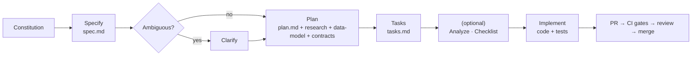

# Delivery Plan: Trace

**Status:** Baseline · **Last updated:** 2026-06-18

How work flows from idea to shipped increment. This plan is process-and-sequence
oriented (no calendar estimates); it complements the [roadmap](./roadmap.md) and
the [development workflow](../04-engineering/development-workflow.md).

---

## Operating model

Trace uses **Spec-Driven Development** with **incremental, stage-based delivery**.
Each stage (= one feature under `specs/`) is independently specified, built behind its
own branch, tested to its Definition of Done, and merged via PR, leaving the
product working at every step.

## The unit of delivery: a feature

Every feature follows the same lifecycle (Constitution III):

## Definition of Ready (a feature may start when...)

- Its spec exists with prioritized, independently-testable user stories.
- All `[NEEDS CLARIFICATION]` markers are resolved.
- A plan passes the Constitution Check.
- Tasks are generated and ordered.

## Definition of Done (a feature is complete when...)

- All targeted acceptance scenarios pass via automated tests.
- Release-blocking NFRs for the slice are met (isolation, no-data-loss, etc.).
- Documentation reflecting any behavior change is updated.
- CI is green and the change is merged via PR.
- The relevant [traceability matrix](../01-requirements/traceability-matrix.md) rows are filled.

## Increment plan (value at each step)

| Increment | Feature | User-visible value | Gate |
|---|---|---|---|
| MVP | 001 Foundation & Capture | "I can log moments privately and they persist." | SC-1..5 |
| +Retrieval | 002 Search & Tags | "I can find anything in my corpus." | SC-6 (search) |
| +Ownership | 003 Export | "I can take all my data with me." | SC-7 |
| GA | 004 Hardening & Deploy | "It's secure, recoverable, and live." | release NFRs |

## Branching & integration

- One short-lived feature branch per feature, off `main`.
- Small, logical commits; PR per feature (or per coherent sub-slice).
- `main` stays releasable at all times. See [git workflow](../04-engineering/git-workflow.md).

## Quality gates (every PR)

Lint → typecheck → unit → integration (incl. isolation suite) → e2e (for UI
slices). A red pipeline blocks merge (Constitution IV). See [ci-cd](../04-engineering/ci-cd.md).

## Risk & change management

- Risks are tracked in the [risk register](./risk-register.md) and reviewed each stage.
- Scope changes that touch V1 boundaries require updating the [SRS](../01-requirements/srs.md); principle changes require a Constitution amendment.

## Roles

See [RACI](./raci.md). In the current single-maintainer setup, one person holds
Product/Eng/Ops roles under the Constitution; the role separation still governs *what hat* is being worn for a given
decision.

## Reporting / progress signal

Progress is read directly from the artifacts, not status decks:

- Feature `tasks.md` checkboxes = build progress.
- CI status = quality signal.
- Traceability matrix coverage = completeness signal.
- Roadmap stage status = release signal.
