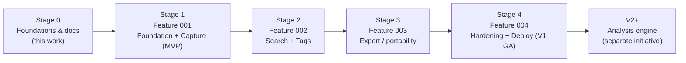

# Roadmap: Trace

**Status:** Baseline · **Last updated:** 2026-06-18

A **stage-based** roadmap. Stages are sequenced by dependency and value, not by
calendar dates. Each stage is a shippable increment that leaves the product
working. Stages map to features under [`specs/`](../../specs/).

> Sequencing principle (Constitution VII + I): ship the smallest thing that
> delivers value, validate it, then build the next slice on top.

---

## Stage map

---

## Stage 0: Foundations & documentation *(current)*

**Goal:** a fully specified, governed project ready to build.

- Flow diagrams, enterprise documentation, SRS baseline.
- Constitution ratified; **all V1 features (001-004) fully
  specified** (spec + plan + research + data-model + contracts + tasks).
- **Design layer** (`docs/06-design/`): V1 wireframes captured as a UI/UX spec, the
  dark-first two-theme color system + design tokens (ADR-0006), and a component
  inventory.

**Exit criteria:** docs reviewed; Constitution v1.0.0; `specs/001`-`specs/004`
spec+plan+tasks complete; design layer baselined.
**Status:** ▣ in progress (this PR).

## Stage 1 · Feature 001: Foundation & Core Capture Loop *(the MVP)*

**Goal:** register, sign in (isolated), capture timestamped moments that persist,
browse the day-grouped timeline, curate entries.

- Backend: config, models, auth + isolation middleware, entry service, REST API, health.
- Frontend: auth screens, focused capture input, optimistic commit, day-grouped timeline.
- Tests: auth, isolation suite, capture/persistence, timeline; e2e capture loop.

**Exit criteria (Definition of Done):** all P1 acceptance scenarios pass; isolation
proven; entries survive reload/restart; CI green. See
[`specs/001-foundation-and-capture/`](../../specs/001-foundation-and-capture/).
**Delivers:** SC-1..SC-5. **Status:** ▢ next.

## Stage 2 · Feature 002: Search & Tags

**Goal:** make the corpus retrievable at depth.

- Inline `#tag` parsing (FR-1.6), tag index with counts (FR-5.1/5.2).
- Full-text search (FR-4.1) + tag/date filters (FR-4.2/4.3), command-palette (⌘K) surface.
- Indexes: `{userId, tags}`, text/search strategy on `body`.

**Exit criteria:** search < 300 ms at 50k entries (NFR-1.3); filters combine (FR-4.4).
**Delivers:** SC-6 (search half). **Status:** ▢ specified, spec+plan+tasks ready
([`specs/002`](../../specs/002-search-and-tags/)).

## Stage 3 · Feature 003: Export & Portability

**Goal:** make data ownership real.

- Markdown export (FR-6.1), JSON export (FR-6.2), scoped export (FR-6.3).
- Round-trippable JSON; (import FR-6.4 optional).

**Exit criteria:** full corpus exports to MD+JSON; round-trip verified (NFR-5.1/5.2).
**Delivers:** SC-7. **Status:** ▢ specified, spec+plan+tasks ready
([`specs/003`](../../specs/003-export-portability/)).

## Stage 4 · Feature 004: Hardening & Deploy (V1 GA)

**Goal:** production-ready, operable, secure.

- Credential recovery (FR-7.5), account deletion (FR-7.6), settings (FR-7.7).
- Rate limiting, security review, accessibility pass, performance validation.
- CI/CD pipeline, deployment, runbooks, backups, health/observability wired.

**Exit criteria:** all release-blocking NFRs met; deployable via config; runbooks exist.
**Delivers:** V1 General Availability. **Status:** ▢ specified, spec+plan+tasks ready
([`specs/004`](../../specs/004-hardening-and-deploy/)).

## V2+: Analysis & insights *(separate initiative)*

The reason the corpus must be clean from day one. Out of scope for V1; begins only
after a real corpus exists. Candidates: pattern detection, dashboards,
recommendations, voice capture, integrations, offline/sync. Each will get its own
spec, plan, and, where architecturally significant. ADRs.

---

## Scope discipline

| In V1 | Out of V1 (V2+) |
|---|---|
| Capture, timeline, search, tags, export | Analysis/insights engine, dashboards |
| Multi-user isolated accounts | Collaboration, sharing, teams, roles |
| Local-first dev, hosted via config | Offline-first / real-time sync |
| Text entries | Voice / image capture |
| Email+password auth | SSO / MFA |

Anything attempting to pull a V2+ item into V1 is rejected unless the SRS and
Constitution are formally amended.

## Dependencies between stages

- Stage 1 is a hard prerequisite for all later stages (it creates the entity, auth, and API).
- Stages 2 and 3 both depend on Stage 1 but are independent of each other and could be sequenced either way; the roadmap prefers Search → Export.
- Stage 4 depends on the feature set being complete enough to harden and operate.
