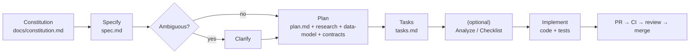

# Development Workflow — Trace

**Status:** Baseline · **Last updated:** 2026-06-18 · **Audience:** contributors

How a change goes from idea to merged code in Trace. This is the **Spec-Driven
Development (SDD)** workflow,
governed by the [Constitution](../constitution.md).

---

## The golden rule

> **No code without a spec; no spec without the Constitution.**
> Code → task → plan → spec → Constitution. Every artifact traces upward.

## The SDD loop

## Step-by-step: building a feature

1. **Confirm the Constitution** governs your intent. If a principle is in the way, the answer is usually to change the approach — amending the Constitution is rare and deliberate.
2. **Specify** the feature: prioritized, independently-testable user stories; functional requirements; success criteria; assumptions. No tech, no code in the spec.
3. **Clarify** if anything is ambiguous (`[NEEDS CLARIFICATION]` must be resolved before planning).
4. **Plan**: pick the technical approach within the stack; pass the **Constitution Check** gate; produce research (decisions), data-model, and API contracts.
5. **Tasks**: generate an ordered, story-grouped task list. Critical-path tests come first (Constitution IV).
6. *(Optional)* **Analyze / Checklist** to catch gaps before building.
7. **Implement**: work tasks in order; write failing tests first for critical paths; commit in small logical units.
8. **Open a PR**: pass all gates, update docs, fill the traceability matrix, get review, merge.

## Local-first development

The whole stack runs on your machine against a local MongoDB; you promote to a
host via configuration only (Constitution; [environments](./environments.md)).
"Local" ≠ "offline" — the client still needs its (local) backend running. See the
feature [quickstart](../../specs/001-foundation-and-capture/quickstart.md).

## Contribution rules

- Every change traces to a task, plan and spec.
- Critical paths get tests, and CI stays green.
- Nothing self-merges; changes land through a reviewed PR (see [RACI](../03-project/raci.md)).
- Docs stay in sync. A behavior change with stale docs is incomplete.

## Definition of Ready / Done

See [delivery-plan](../03-project/delivery-plan.md). In short: **Ready** = spec +
resolved clarifications + plan passing Constitution Check + tasks. **Done** =
acceptance scenarios pass + release-blocking NFRs met + docs updated + CI green +
merged.

## Where things live

| Artifact | Location |
|---|---|
| Constitution | `docs/constitution.md` |
| Feature specs/plans/tasks | `specs/NNN-name/` |
| Enterprise docs | `docs/` |
| Diagrams | `docs/diagrams/` |
| App code (when built) | `backend/`, `frontend/` |
