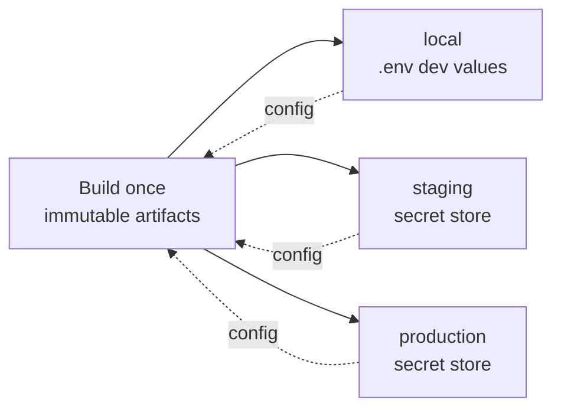

# Environments & Configuration: Trace

**Status:** Baseline · **Last updated:** 2026-06-18

Trace runs the same code in every environment, differing **only by configuration
and secrets** (Constitution VI; NFR-3.2). This document defines the environments
and the configuration contract.

---

## Environments

| Environment | Purpose | Datastore | TLS | Secrets source |
|---|---|---|---|---|
| **local** | Developer machine; local-first loop | Local MongoDB (or Docker) | optional | `.env` (gitignored, dev-only values) |
| **test/CI** | Automated gates | `mongodb-memory-server` (ephemeral) | n/a | CI-provided env |
| **staging** | Pre-prod verification | Managed MongoDB (separate) | required | Platform secret store |
| **production** | Live service | Managed MongoDB | required | Platform secret store |

> **Local ≠ offline.** The local environment runs the full stack on your machine
> without needing the internet (after install), but the client still requires its
> local backend + Mongo to be running. Offline-first is out of scope (see
> [glossary](../00-overview/glossary.md)).

## Configuration contract

The backend reads configuration through a **single validated config module** that
parses environment variables at startup and **fails fast** if anything is missing
or invalid ([R-10](../../specs/001-foundation-and-capture/research.md)).

### Backend variables

| Variable | Required | Example | Notes |
|---|---|---|---|
| `NODE_ENV` | yes | `development` / `production` | Standard Node env |
| `PORT` | yes | `4000` | API listen port |
| `MONGODB_URI` | yes | `mongodb://localhost:27017/trace_dev` | Connection string (secret in hosted) |
| `JWT_SECRET` | yes | `<random>` | Token signing key: **secret** |
| `JWT_EXPIRES_IN` | no | `24h` | Access-token lifetime |
| `ALLOWED_ORIGINS` | yes | `http://localhost:5173` | CORS allowlist (comma-separated) |
| `APP_ORIGIN` | yes in production | `https://trace.example.com` | Public web origin for reset links (not localhost in prod) |
| `LOG_LEVEL` | no | `info` | Structured logger level |
| `RATE_LIMIT_*` | no | — | Tunable auth rate limits |
| `MAIL_TRANSPORT` | yes in production (`smtp`) | `log` / `smtp` | `log` for local/dev; **must be `smtp` in production** |
| `SMTP_HOST` / `SMTP_PORT` / `SMTP_USER` / `SMTP_PASS` / `MAIL_FROM` | when `MAIL_TRANSPORT=smtp` | — | SMTP credentials + From address |

### Frontend variables

| Variable | Required | Example | Notes |
|---|---|---|---|
| `VITE_API_BASE` | no | `/api` | API base path; same-origin on Vercel (default). Set to full URL for split-origin dev. |

## `.env` discipline

- Each package has a committed **`.env.example`** documenting all variables with safe placeholder values.
- Real `.env` files are **gitignored** and never committed.
- Production/staging secrets live in the hosting platform's secret store, injected at runtime, never in the repo or image.

## Promotion model

Same artifacts everywhere; behavior is steered by config alone. This is what makes
deploys reproducible and rollbacks safe.

## Secrets handling rules

1. Never commit secrets; `.env` is gitignored.
2. Production secrets come from the platform secret store.
3. Rotate `JWT_SECRET` and DB credentials per the [runbook](../05-operations/runbook.md); rotating `JWT_SECRET` invalidates existing tokens (expected).
4. The app fails to start on missing/invalid required config (no silent insecure defaults).

## Local setup pointer

Step-by-step local run + verification is in the feature
[quickstart](../../specs/001-foundation-and-capture/quickstart.md).
