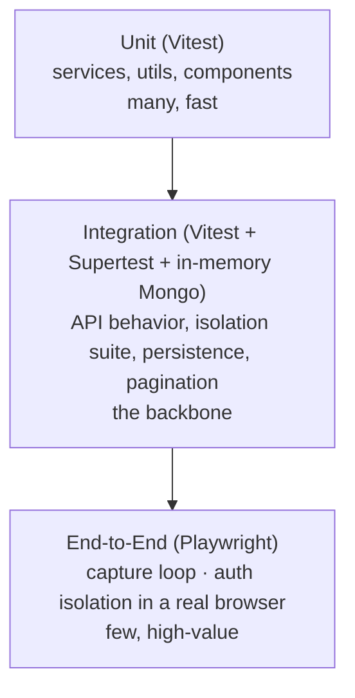

# Testing Strategy: Trace

**Status:** Baseline · **Last updated:** 2026-06-18

How Trace proves correctness. Testing is a release gate, not an afterthought
(Constitution IV: Test-First & Quality Gates).

---

## Philosophy

- **Test the critical paths first**: authentication, **per-user isolation**, capture/commit, persistence. These are written before or alongside implementation.
- **Red-Green-Refactor** for non-trivial logic.
- Tests are **deterministic and hermetic**, no reliance on external services or wall-clock flakiness.
- A test exists to protect a requirement; it traces back via the [matrix](../01-requirements/traceability-matrix.md).

## The test pyramid

| Layer | Tooling | Scope |
|---|---|---|
| **Unit** | Vitest | Pure logic: services, day-grouping, validators, components. Fast, numerous. |
| **Integration** | Vitest + Supertest + `mongodb-memory-server` | API endpoints against a real (in-memory) Mongo: real queries, indexes, isolation. The backbone of confidence. |
| **End-to-end** | Playwright | The capture loop and auth isolation through the real UI. Few, high-value. |

## Required suites (release-blocking)

| Suite | Proves | Requirement |
|---|---|---|
| **Auth** | register/login/logout, duplicate email, bad password, rate limiting | FR-7.*, NFR-4.5 |
| **Isolation** | user B can never read/patch/delete user A's data via any endpoint | FR-7.4, NFR-4.3, SC-4 |
| **Capture/persistence** | `occurredAt` default, immutable `createdAt`, empty-body reject, survives restart | FR-1.2/1.3/2.3, SC-5 |
| **Timeline** | reverse-chrono, day grouping, cursor pagination, excludes deleted | FR-3.*, NFR-1.4 |
| **Curation** | edit, backdate (re-sort), soft-delete, restore; `createdAt` never mutated | FR-1.5/2.1/2.2 |
| **Capture loop (e2e)** | focus-on-load, Enter commits, Shift+Enter newline, reload persists | FR-1.1/1.3/1.4, SC-1/3 |

The **isolation** and **no-data-loss** suites are the two that must never be
skipped; they protect the product's core promises.

## Conventions

- Tests live under each package's `tests/` (`unit/`, `integration/`, `isolation/`, `e2e/`).
- One behavior per test; descriptive names ("rejects entry with empty body").
- Integration tests spin up an in-memory Mongo per suite; no shared mutable state between tests.
- Time-sensitive tests inject a clock or assert ranges, never sleep on real time.
- Fixtures/factories create users and entries; never hardcode IDs.

## Non-functional verification

| NFR area | How |
|---|---|
| Performance (NFR-1) | Benchmarks for capture latency, cold load, search; assert budgets (SC-2/3/6). |
| Scalability (NFR-10) | Seed 50k entries/user; measure timeline + search. |
| Security (NFR-4) | Isolation suite + dependency advisory checks + manual security review pre-GA. |
| Accessibility (NFR-7.4) | Automated a11y checks (axe) in e2e + manual keyboard pass. |

## Coverage policy

- Coverage is a **signal, not a target**; we measure it but gate on *critical-path* coverage, not a blanket percentage.
- Every **Must** functional requirement has at least one automated verification before its feature is "done."

## CI integration

All suites run in CI on every PR; a red pipeline blocks merge. See
[ci-cd](./ci-cd.md). The manual acceptance script lives in each feature's
[quickstart](../../specs/001-foundation-and-capture/quickstart.md).

## What we deliberately don't over-test

- Third-party library internals.
- Trivial getters/wiring with no logic.
- The client re-asserting server-enforced rules (we test the server's enforcement, and the UX of the client).
