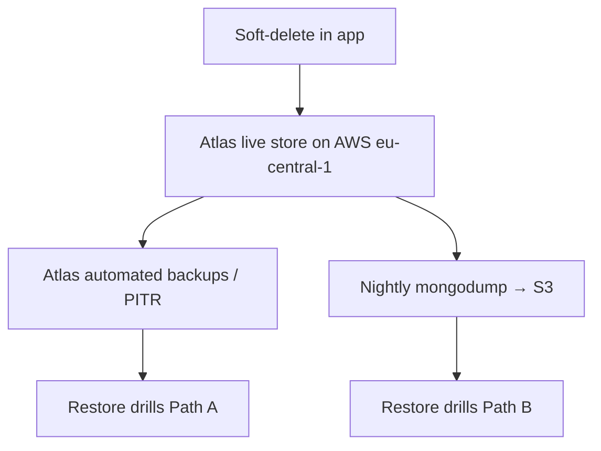

# Backup & Recovery: Trace

**Status:** Operational overlay · **Last updated:** 2026-07-15

The corpus is the product (Constitution II). Losing a user's moments is the worst
non-privacy failure Trace can have. This document defines how data is protected
and recovered.

Companion docs:

- [AWS off-box backups](./aws-backup.md), S3 + OIDC + scripts
- [Restore drill](./restore-drill.md). Path A / Path B procedure

---

## Objectives

| Objective | Target (V1) | Rationale |
|---|---|---|
| **RPO** (max acceptable data loss) | Small: minutes via Atlas PITR where available; ≤ 24h for S3 nightly | "No committed entry is ever lost" (SC-5) beyond a single DB instance. |
| **RTO** (max acceptable downtime to restore) | Hours | V1 showcase is not mission-critical, but restoration must be proven. |

## What is backed up

- **MongoDB.** The entire datastore (users + entries). This *is* the corpus. V1 has no S3/GridFS blob store for moments.
- **Configuration/secrets.** Vercel env + AWS SSM; not inside mongodump archives.
- Application **artifacts**, reproducible from source + CI; not backed up as data.

**Not** prod: local Docker Compose Mongo volumes. `docker compose down -v` wipes **dev only**. Never treat Compose as production recovery.

## Durability layers

| Layer | System | Role |
|---|---|---|
| Hot path | Vercel + Atlas | Live corpus |
| Provider backup | Atlas Cloud Backup / PITR | Path A |
| Off-box second copy | S3 `ahmdmshazly-trace-backups` | Path B: survives Atlas-only failure |
| Proven | Quarterly restore drill | See [restore-drill.md](./restore-drill.md) |

## Backup strategy

1. **Atlas.** Enable automated backups / PITR on the production cluster (AWS `eu-central-1`). Encryption at rest on.
2. **S3 nightly.** GitHub Actions OIDC → IAM role `trace-backup-gha` → `mongodump` gzip archive under `trace/YYYY/MM/DD/`. See [aws-backup.md](./aws-backup.md).
3. **Pre-migration.** Mandatory dump/snapshot before schema migrations ([runbook](./runbook.md)).

## Restore procedures

### Path A: Atlas PITR / snapshot

1. Declare Sev1 if production is impacted; stop writes if corruption is active.
2. Restore to a **new** Atlas instance (or scratch DB) at the chosen timestamp.
3. Verify integrity (counts, spot-check entries, isolation).
4. Re-point Vercel `MONGODB_URI`; confirm `/api/health` + capture smoke.
5. Postmortem.

### Path B: S3 archive

1. `DRY_RUN=1 ./scripts/backup/restore-from-s3.sh` to identify the object.
2. `mongorestore` into **scratch** URI only (`RESTORE_MONGODB_URI` ≠ prod).
3. Verify, then cut over `MONGODB_URI` only if this is the recovery plan.

### Soft-delete / single-user

Most "I lost an entry" cases are in-app restore (soft-delete), not a DB operation
([data-model](../02-architecture/data-model.md)).

## Instance-terminate story

There is **no** Trace app EC2 in production. Terminating EduBridge/DealerIQ hosts
does not affect Trace. Atlas + S3 survive. Laptop Compose loss is irrelevant to prod.

## Responsibilities

Ops owns backups, retention, and drills ([RACI](../03-project/raci.md)). Backup
workflow failure is visible as a failed GitHub Actions run
([observability](./observability.md)).

## Checklist

- [ ] Atlas automated backups / PITR enabled
- [ ] SSM `/trace/prod/MONGODB_URI` set; Vercel `MONGODB_URI` set
- [ ] GitHub variable `AWS_ROLE_ARN` set; first backup workflow green
- [ ] At least one Path A or Path B restore drill recorded
- [ ] Pre-migration backup step in the release runbook
