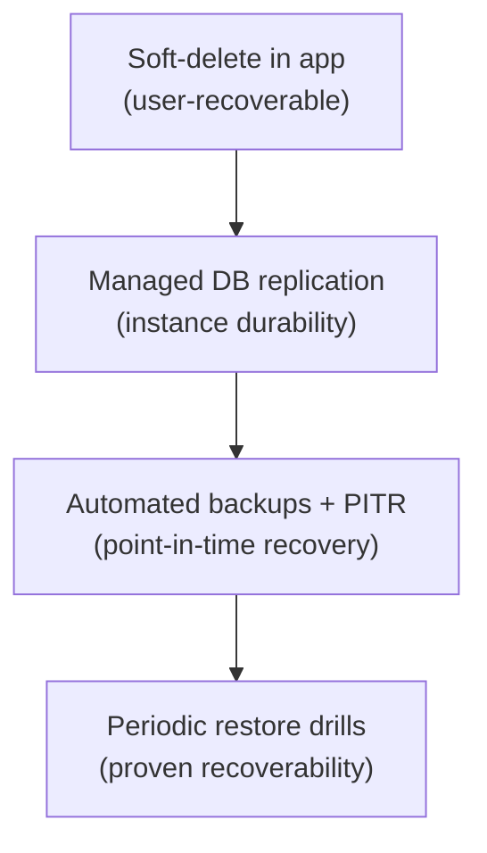

# Backup & Recovery — Trace

**Status:** Baseline (operational from Stage 4 / GA) · **Last updated:** 2026-06-18

The corpus is the product (Constitution II). Losing a user's moments is the worst
non-privacy failure Trace can have. This document defines how data is protected
and recovered.

---

## Objectives

| Objective | Target (V1) | Rationale |
|---|---|---|
| **RPO** (max acceptable data loss) | Small — minutes, via point-in-time recovery | "No committed entry is ever lost" (SC-5) is the promise; backups make it durable beyond a single DB. |
| **RTO** (max acceptable downtime to restore) | Hours | V1 is not yet mission-critical infrastructure, but restoration must be proven and reasonable. |

These targets are revisited as the user base grows.

## What is backed up

- **MongoDB** — the entire datastore (users + entries). This *is* the corpus.
- **Configuration/secrets** — managed in the platform secret store (versioned there), not in backups of application data.
- Application **artifacts** are reproducible from source + CI and are not "backed up" in the data sense.

## Backup strategy

- Use the **managed MongoDB provider's automated backups** with **point-in-time recovery (PITR)** where available.
- Retain a rolling window of backups (e.g. daily snapshots + continuous oplog for PITR); retention is sized to balance cost and safety.
- Backups inherit **encryption at rest** (NFR-4.7).
- A **pre-migration backup** is mandatory before any schema migration ([runbook](./runbook.md)).

## Restore procedures

### Full restore (DB lost/corrupted)

1. Declare a Sev1 incident; stop writes if corruption is active.
2. Identify the target restore point (latest good snapshot or PITR timestamp).
3. Restore to a new database instance from the provider's backup.
4. Verify integrity (counts, spot-check entries, isolation intact).
5. Re-point `MONGODB_URI` to the restored instance; roll API instances.
6. Verify `/api/health` + capture smoke + isolation smoke.
7. Postmortem.

### Point-in-time recovery (bad write/migration)

1. Choose the timestamp just before the bad event.
2. PITR-restore to a new instance.
3. Verify, re-point, validate, communicate.

### Partial / single-user recovery

- Because V1 uses **soft-delete only** (no hard delete), most "I lost an entry"
  cases are a **restore** in-app, not a DB operation ([data-model](../02-architecture/data-model.md)).
- For deeper loss, restore a backup to a scratch instance and extract the needed
  documents.

## Recovery drills

- Periodically **restore a backup to a scratch environment** and run integrity +
  isolation checks. An untested backup is not a backup.
- Record drill results; failures become [risk register](../03-project/risk-register.md) items.

## Durability layers (defense in depth)

## Responsibilities

Ops is accountable for backups, retention, and restore drills (see
[RACI](../03-project/raci.md)). Backup failure is an alertable event
([observability](./observability.md)).

## Pre-GA checklist

- [ ] Automated backups enabled with PITR.
- [ ] Retention window configured.
- [ ] Encryption at rest confirmed.
- [ ] At least one successful restore drill completed.
- [ ] Pre-migration backup step in the release runbook.
