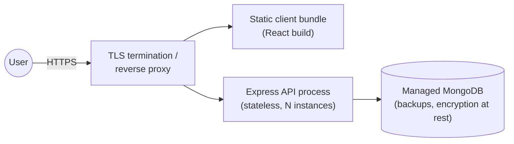

# Deployment — Trace

**Status:** Production on Vercel · **Last updated:** 2026-07-15

How Trace is deployed to a hosted environment. Trace is **config-driven**: the
same artifacts run everywhere, steered only by environment configuration
(Constitution VI; NFR-3.2/3.3). The API is **stateless** (NFR-3.4), enabling
rolling redeploys without sticky sessions.

**Canonical production URL (current):** https://trace-one-swart.vercel.app  
(aliases: `trace-ahmdmshazly.vercel.app`). Custom domain `trace.ahmdmshazly.me` is
not configured yet. Release path: **push to `main`** on `ahmedmshazly/trace`
(GitHub ↔ Vercel linked; production branch `main`).

---

## Topology



- **Client**: built static assets (`vite build`) served by the edge/CDN or the API host.
- **API**: one or more stateless Node processes behind the proxy.
- **Database**: managed MongoDB with backups and encryption at rest.

## Prerequisites

- A Linux host / platform for the API (NFR-9.1).
- A managed MongoDB instance reachable from the API.
- TLS certificate(s) at the edge (NFR-4.1).
- A secret store for `JWT_SECRET`, `MONGODB_URI`, etc. ([environments](../04-engineering/environments.md)).

## Build (once)

```bash
# API
cd backend && npm ci && npm run build      # → dist/

# Client
cd frontend && npm ci && npm run build     # → dist/ (static)
```

Artifacts are immutable and promoted unchanged across environments.

## Configure (per environment)

Provide configuration via the platform's environment/secret mechanism — never the
repo. Required: `NODE_ENV=production`, `PORT`, `MONGODB_URI`, `JWT_SECRET`,
`ALLOWED_ORIGINS`. See the [configuration contract](../04-engineering/environments.md).

## Release procedure

1. Confirm CI is green on `main` and release-blocking NFRs hold ([ci-cd](../04-engineering/ci-cd.md)).
2. Build artifacts (or reuse the CI-built artifacts).
3. Apply configuration/secrets for the target environment.
4. Roll out the new API instances (rolling/blue-green); serve the new client bundle.
5. **Verify** `/api/health` returns healthy on the new instances before shifting traffic.
6. Smoke-test the capture loop and an isolation check in the target environment.
7. Announce/record the release (tag + notes).

## Rollback

Because artifacts are immutable and the API is stateless:

1. Re-point traffic to the previous artifact/instances (or redeploy the prior tag).
2. Confirm `/api/health` and a capture smoke test.
3. If a schema migration was involved, follow the migration's documented down-path (migrations are designed to be safe/backward-compatible; see [data-model](../02-architecture/data-model.md)).

## Database migrations

- Schema changes ship with a migration script and an ADR (Constitution).
- Migrations are applied as a deliberate step in the release, with a backup taken first ([backup-recovery](./backup-recovery.md)).
- Index changes are verified against performance targets after rollout.

## Post-deploy verification checklist

- [ ] `/api/health` healthy on all instances.
- [ ] Register + capture + read-back works (smoke).
- [ ] Isolation smoke: a second user sees an empty corpus.
- [ ] TLS valid; security headers present.
- [ ] Logs flowing; no error spikes.
- [ ] Backups confirmed running.

## Vercel deployment

Trace includes first-class Vercel support for a **same-origin** full-stack deploy:
the Vite client (`frontend/dist`) is served as static assets and the Express API
runs as a serverless function via [`api/index.js`](../../api/index.js).

### Configuration

| File | Purpose |
|---|---|
| [`vercel.json`](../../vercel.json) | Install/build commands, SPA rewrites, API routing, security headers |
| [`api/index.js`](../../api/index.js) | Serverless entry — boots Express with a cached MongoDB connection |
| [`.env.example`](../../.env.example) | Required environment variables for hosted deploy |

### Required environment variables

Set these in the Vercel project (Settings → Environment Variables):

| Variable | Notes |
|---|---|
| `MONGODB_URI` | Managed MongoDB connection string (Atlas recommended) |
| `JWT_SECRET` | Long random secret (`openssl rand -hex 32`) |
| `ALLOWED_ORIGINS` | Production domain(s), comma-separated |
| `APP_ORIGIN` | Public web origin used in password-reset links (must not be localhost) |
| `NODE_ENV` | `production` |
| `MAIL_TRANSPORT` | Must be `smtp` in production |
| `SMTP_HOST` / `SMTP_PORT` / `SMTP_USER` / `SMTP_PASS` / `MAIL_FROM` | Required when `MAIL_TRANSPORT=smtp` |

Preview deployments work without listing every preview URL — `VERCEL_URL` and
`VERCEL_BRANCH_URL` are added to the CORS allowlist automatically.

### Deploy

Preferred: merge/push to **`main`** — Vercel auto-deploys from GitHub.

```bash
# Local parity with what Vercel runs
npm run install:all
npm run vercel-build

# Manual promote (optional)
vercel --prod
```

The client uses `/api` as its base URL by default (same origin). No
`VITE_API_BASE` override is needed on Vercel unless the API is hosted elsewhere.

### MongoDB Atlas notes

- Cluster provider **AWS**, region **`eu-central-1`** (near Vercel `fra1`).
- Network access: `0.0.0.0/0` for serverless + GitHub Actions dump runners, or
  tighten later with static egress.
- DB user with read/write on database `trace`.
- Set `MONGODB_URI` on Vercel (Production + Preview) **and** SSM
  `/trace/prod/MONGODB_URI` for the [S3 backup workflow](./aws-backup.md).
- Enable Atlas automated backups / PITR on the tier before treating the
  deployment as durable.
- Set `ALLOWED_ORIGINS=https://trace-one-swart.vercel.app` (update when a
  custom domain lands).

## Scaling path (when needed)

- Add API instances (stateless → horizontal scale).
- Scale the managed MongoDB tier; add indexes per query patterns.
- Introduce a CDN for static assets.
- (Only when justified by data) revisit caching/read replicas via an ADR.
