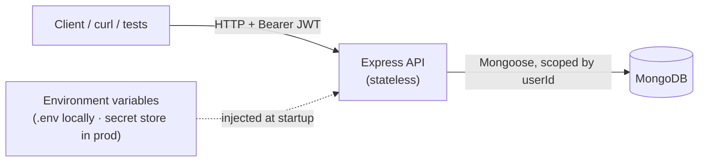

# Run, Test & Deploy — Trace (hands-on guide)

**Status:** Baseline · **Last updated:** 2026-06-20

A practical, **learn-by-doing** walkthrough of the Trace backend: how to run it,
how to test it, and how to deploy it — with enough explanation of *why* each step
exists that you can operate it confidently.

If you just want the terse setup, see
[local-development.md](./local-development.md). This document is the longer,
teaching version. It assumes the one-time install (Node 22, MongoDB 8) from that
guide is already done.

---

## 0. The mental model (read this first)

Trace's backend is a **stateless Express API** that stores everything in
**MongoDB**. "Stateless" means the API process keeps **no** session in memory —
your identity travels on every request as a **JWT** (a signed token). That is why
you can run many copies of the API and restart them freely: all the durable state
lives in Mongo.



Three things steer the app, and they never live in the source code:

| Concern | Locally | In production |
|---|---|---|
| **Config & secrets** | `backend/.env` file | platform secret store (injected as env vars) |
| **Database** | local `mongod` on `:27017` | managed MongoDB |
| **The code** | same `dist/` build | the *same* `dist/` build |

> Key idea (12-factor): **the artifact is identical everywhere; only the
> configuration changes.** That is what makes deploys reproducible and rollbacks
> safe. Keep this in mind and everything below makes sense.

Two rules the API enforces that you'll see while testing:

- **Per-user isolation** — every database query is scoped by `userId`. A foreign
  or non-existent record always returns `404` (existence is never revealed).
- **`createdAt` is immutable** — set once on capture, never changed. You can
  backdate `occurredAt` (when a moment *happened*), but not the commit instant.

---

## 1. One-time setup (recap)

You only do this once per machine. Full details + install commands are in
[local-development.md](./local-development.md). The short version:

```bash
# 1) Node 22 (via nvm)
nvm install 22 && nvm use 22
node -v        # v22.x

# 2) MongoDB 8 running as a service
sudo systemctl enable --now mongod
mongosh --quiet --eval "db.runCommand({ ping: 1 })"   # { ok: 1 }

# 3) Backend dependencies + config
cd backend
npm install
cp .env.example .env
sed -i "s/^JWT_SECRET=.*/JWT_SECRET=$(openssl rand -hex 32)/" .env
```

> **Why `JWT_SECRET` matters:** it signs every login token. If it's weak, tokens
> can be forged; if you rotate it, all existing tokens become invalid (everyone
> must log in again). The app refuses to start if it's shorter than 16 chars.

**Every new terminal**, before running `npm`: `nvm use 22` (or `cd backend &&
nvm use`, which reads `backend/.nvmrc`). This project's `node` only has `npm`
attached when nvm has selected it.

---

## 2. Running the API

### 2a. Development mode (what you'll use daily)

```bash
cd backend
npm run dev
```

What this does, piece by piece:

- `npm run dev` runs `tsx watch --env-file-if-exists=.env src/server.ts`.
- **`tsx`** runs TypeScript directly (no separate compile step).
- **`watch`** restarts the server automatically when you edit a file.
- **`--env-file-if-exists=.env`** loads your `.env` into the process before the
  app reads it. (The app code itself only reads `process.env` — see the mental
  model. The `-if-exists` part means it won't crash when there's no `.env`, e.g.
  in CI.)

Healthy startup looks like:

```text
INFO: MongoDB connected   db: "trace_dev"
INFO: Trace API listening  port: 4000  env: "development"
```

Leave it running. In **another terminal**, hit it:

```bash
curl -s http://localhost:4000/api/health | jq
# { "status": "ok", "uptime": 12.3, "db": "connected" }
```

Stop the server with **Ctrl-C** in its terminal.

### 2b. Production mode locally (the real artifact)

This is exactly what runs in production — a compiled build, no `tsx`:

```bash
cd backend
npm run build      # TypeScript -> dist/  (this is the immutable artifact)
npm start          # node --env-file-if-exists=.env dist/server.js
```

Use this to confirm the build is healthy before deploying.

### 2c. Managing the process

```bash
# Is something already on port 4000?
ss -ltnp | grep :4000

# Find/stop stray servers
pgrep -af "tsx watch"; pgrep -af "dist/server.js"
pkill -f "tsx watch"; pkill -f "dist/server.js"
```

If you start while an old server still holds `:4000`, you'll get `EADDRINUSE` —
stop the old one or set a different `PORT` in `.env`.

### 2d. Inspecting the database

The data is real and persists across restarts. Look at it with `mongosh`:

```bash
mongosh "mongodb://localhost:27017/trace_dev" --quiet --eval '
  print("users:", db.users.countDocuments());
  print("entries:", db.entries.countDocuments());
  printjson(db.entries.find().sort({ occurredAt: -1 }).limit(3).toArray());
'
```

Reset your local data when you want a clean slate (destructive — local only):

```bash
mongosh "mongodb://localhost:27017/trace_dev" --quiet --eval "db.dropDatabase()"
```

---

## 3. Testing

There are **two complementary levels**. Learn both — they catch different things.

### 3a. Automated code tests (the safety net)

These run on a throwaway in-memory MongoDB (`mongodb-memory-server`), so they
never touch your `trace_dev` data and need no running server.

```bash
cd backend
npm test                 # run everything once
npm run test:watch       # re-run on file changes (great while coding)
npm run test:coverage    # everything + a coverage report
```

Expected:

```text
 Test Files  9 passed (9)
      Tests  32 passed (32)
```

What lives where, and what each suite *proves*:

| Folder | Proves |
|---|---|
| `tests/unit/` | pure logic — password hashing, JWT sign/verify |
| `tests/integration/` | real API behavior over real queries: auth, health, capture, timeline/pagination, curation, rate limiting |
| `tests/isolation/` | user B can **never** read/patch/delete user A's data |

> **Why a config file matters here:** `backend/vitest.config.ts` loads
> `tests/setup.ts` *before* any `src/*` import, so test env vars exist when the
> config module validates them at import time. Without it, every test would fail
> with "Invalid configuration".

Reading coverage: it prints `% Stmts / % Branch / % Funcs / % Lines` per file.
Coverage is a **signal, not a target** — the rule is that every critical path
(auth, isolation, capture/persistence) has a test, which it does.

### 3b. Live API acceptance (the smoke test)

This drives a **real running server** end-to-end with `curl` — the closest thing
to "use the product." Start the server, then in another terminal:

```bash
cd backend
BASE_URL=http://localhost:4000/api ./scripts/smoke-api.sh
```

It prints PASS/FAIL for ~42 checks across health, auth (and the error envelopes
like `401 INVALID_CREDENTIALS`, `409 EMAIL_IN_USE`), capture, timeline +
pagination, curation (incl. `createdAt` immutability), isolation, and rate
limiting. Exit code is non-zero if anything fails (so CI/scripts can gate on it).

```text
  passed: 42   failed: 0
```

Two things to know:

- It uses a **unique email per run**, so it's safe to run repeatedly against the
  persistent DB.
- The **rate-limit check runs last** because it deliberately trips the limiter
  (`RATE_LIMIT_MAX` logins → `429`). To run the script again immediately,
  **restart the server** (the limiter is in-memory and resets on restart).

### 3c. Manual exploration

[`backend/api.http`](../../backend/api.http) is a clickable request collection for
the VS Code **REST Client** extension (or JetBrains HTTP client). Open it, run
the `register` request, and the token is captured and reused for the rest. Great
for poking at one endpoint at a time.

You can also do it by hand:

```bash
# Register and keep the token
TOKEN=$(curl -s -X POST http://localhost:4000/api/auth/register \
  -H 'content-type: application/json' \
  -d '{"email":"me@example.com","password":"correct horse battery"}' | jq -r .token)

# Capture a moment
curl -s -X POST http://localhost:4000/api/entries \
  -H "authorization: Bearer $TOKEN" -H 'content-type: application/json' \
  -d '{"body":"learning the API #trace"}' | jq

# Read the timeline
curl -s http://localhost:4000/api/entries -H "authorization: Bearer $TOKEN" | jq
```

### 3d. Adding your own test (mini example)

Create `tests/unit/example.test.ts`:

```ts
import { describe, it, expect } from 'vitest';

describe('arithmetic sanity', () => {
  it('adds', () => {
    expect(1 + 1).toBe(2);
  });
});
```

Run `npm test` — it's auto-discovered (any `tests/**/*.test.ts`). For an
API-level test, copy the pattern in `tests/integration/health.test.ts`: it builds
the app with `createApp()`, boots an in-memory DB via the `tests/helpers/db.ts`
helpers, and drives it with `supertest`.

### The golden rule before pushing

```bash
npm run typecheck && npm run lint && npm run format:check && npm test
```

All four must pass — that's what CI enforces on every pull request
([ci-cd](../04-engineering/ci-cd.md)). `npm run format` (no `:check`) auto-fixes
formatting; `npm run lint:fix` auto-fixes lint where possible.

---

## 4. Deploy

Deploying has two layers. **Learn layer A locally first** — it teaches the exact
production shape on your own machine. Layer B is the real hosted release.

### 4a. Layer A — production-like stack on your machine (Docker)

This runs the **API container** against a **MongoDB container**, wired only by
environment — the same topology as production. It's the safest place to learn
deploy mechanics because nothing is public.

```bash
# from the repo ROOT (not backend/)
JWT_SECRET=$(openssl rand -hex 32) docker compose up --build -d
```

What happens:

- `--build` builds the API image from [`backend/Dockerfile`](../../backend/Dockerfile)
  (a multi-stage build: compile in one stage, ship a slim non-root runtime).
- Compose starts `mongo` first, waits until its healthcheck passes, then starts
  the `api`, injecting `MONGODB_URI=mongodb://mongo:27017/trace` and your
  `JWT_SECRET` as **real environment variables** (no `.env` inside the image).

Verify and operate it:

```bash
docker compose ps                      # both should be "healthy"
curl -s http://localhost:4000/api/health | jq
docker compose logs -f api             # follow API logs (Ctrl-C to stop following)
docker compose down                    # stop & remove containers (keeps the DB volume)
docker compose down -v                 # also delete the database volume (clean slate)
```

> Note: on this machine Docker needs `sudo` (the daemon runs as root and your
> user isn't in the `docker` group). Either prefix with `sudo`, or add yourself
> once: `sudo usermod -aG docker $USER` then log out/in.

Mental model of the difference vs. `npm run dev`: same code, but now the API and
DB are isolated containers talking over a private network, configured purely by
env — exactly like a host would do it.

### 4b. Layer B — the real hosted deploy (when you "go online")

Full procedure, topology diagram, and checklists live in
[deployment.md](./deployment.md). The essentials, framed for learning:

**1. Build the immutable artifact (once).** CI builds it; you don't rebuild per
environment.

```bash
cd backend && npm ci && npm run build    # -> dist/
```

`npm ci` installs the **exact** versions from `package-lock.json` (reproducible),
unlike `npm install` which may update the lockfile.

**2. Provision the infrastructure:**

- A Linux host/platform to run the Node process (e.g. a PaaS, a container host,
  or a VM).
- A **managed MongoDB** (e.g. MongoDB Atlas) with backups + encryption at rest.
- **TLS** at the edge (HTTPS) — a reverse proxy / load balancer terminates it.
- A **secret store** for the config below.

**3. Configure per environment** (never in the repo — set these in the platform's
env/secret mechanism):

| Variable | Production value |
|---|---|
| `NODE_ENV` | `production` |
| `PORT` | the port your platform expects |
| `MONGODB_URI` | the managed cluster's connection string (a secret) |
| `JWT_SECRET` | a long random secret from the store |
| `ALLOWED_ORIGINS` | your real client origin(s), e.g. `https://app.yourdomain.com` |

**4. Release:**

1. Confirm CI is green on `main`.
2. Roll out the new API instances (rolling or blue-green — because the API is
   stateless, you can swap instances with no session loss).
3. **Verify `/api/health` on the new instances before sending real traffic.**
4. Run a smoke check (register + capture + a second-user isolation check) against
   the new environment.
5. Tag the release and note it.

**5. Rollback** (because artifacts are immutable + the API is stateless): re-point
traffic to the previous artifact, re-verify `/api/health` and a capture smoke
test. See [deployment.md](./deployment.md) and
[backup-recovery.md](./backup-recovery.md).

### "Going online" checklist (don't skip)

- [ ] `NODE_ENV=production` and a strong, store-provided `JWT_SECRET`.
- [ ] `ALLOWED_ORIGINS` set to your real client origin(s) — **not** `localhost`.
- [ ] Managed MongoDB with **backups enabled** and encryption at rest.
- [ ] TLS valid at the edge; security headers present (the API sets `helmet`).
- [ ] Rate limits reviewed (`RATE_LIMIT_WINDOW_MS` / `RATE_LIMIT_MAX`).
- [ ] `/api/health` returns healthy from every instance.
- [ ] Logs are flowing to your platform; no error spikes after rollout.
- [ ] Tried a rollback once on staging so it's routine, not a surprise.

---

## 5. Everyday cheat sheet

```bash
# --- one-time per terminal ---
nvm use 22                      # make node/npm available (reads .nvmrc in backend/)

# --- run (in backend/) ---
npm run dev                     # dev server w/ reload + .env  -> :4000
npm run build && npm start      # production build + run the compiled artifact
curl -s localhost:4000/api/health | jq

# --- test (in backend/) ---
npm test                        # all suites once
npm run test:watch              # re-run on change
npm run test:coverage           # + coverage
BASE_URL=http://localhost:4000/api ./scripts/smoke-api.sh   # live E2E smoke

# --- quality gates (run before pushing) ---
npm run typecheck && npm run lint && npm run format:check && npm test
npm run format                  # auto-fix formatting
npm run lint:fix                # auto-fix lint

# --- database (local) ---
mongosh "mongodb://localhost:27017/trace_dev" --quiet --eval "db.entries.countDocuments()"
mongosh "mongodb://localhost:27017/trace_dev" --quiet --eval "db.dropDatabase()"  # reset

# --- deploy (production-like, from repo root) ---
JWT_SECRET=$(openssl rand -hex 32) docker compose up --build -d
docker compose ps
docker compose logs -f api
docker compose down             # (-v also drops the DB volume)
```

---

## 6. When something breaks

A symptom-to-fix table covers the common cases (config not loaded, `npm` missing,
port in use, Mongo not running, rate-limit `429`, test config errors) in
[local-development.md → Troubleshooting](./local-development.md#troubleshooting).

The first three questions to ask, in order:

1. **Is Mongo up?** `mongosh --quiet --eval "db.runCommand({ ping: 1 })"`
2. **Is `.env` present and loaded?** Startup error mentioning `MONGODB_URI`/
   `JWT_SECRET` means it isn't — create `backend/.env`.
3. **Is the old server still on `:4000`?** `ss -ltnp | grep :4000`, then `pkill`.

## See also

- [Local Development](./local-development.md) — install + verify details
- [API Testing](../04-engineering/api-testing.md) — suites, smoke script, examples
- [Deployment](./deployment.md) — hosted release procedure, topology, rollback
- [Environments & Configuration](../04-engineering/environments.md) — the config contract
- [Backend README](../../backend/README.md) — API surface and project layout
