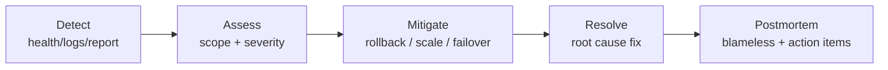

# Operations Runbook — Trace

**Status:** Baseline (operational from Stage 4 / GA) · **Last updated:** 2026-06-18

Step-by-step procedures for running Trace in production. Written so that incidents
are routine, not panic (Constitution VI). Pair with [deployment](./deployment.md),
[observability](./observability.md), and [backup-recovery](./backup-recovery.md).

---

## Quick reference

| Signal | Where |
|---|---|
| Service health | `GET /api/health` |
| Logs | structured app logs (no entry content) — [observability](./observability.md) |
| Config/secrets | platform secret store — [environments](../04-engineering/environments.md) |
| Backups | managed MongoDB backups / PITR — [backup-recovery](./backup-recovery.md) |

## Routine procedures

### Deploy a new release

See [deployment](./deployment.md) → Release procedure. Always verify `/api/health`
and a capture smoke test before shifting full traffic.

### Roll back a release

See [deployment](./deployment.md) → Rollback. Re-point to the previous immutable
artifact; verify health + smoke.

### Rotate secrets

1. Generate a new secret in the platform secret store.
2. Roll the API instances to pick it up.
3. Note: rotating `JWT_SECRET` invalidates existing tokens — users re-authenticate (expected, communicate if needed).

### Apply a database migration

1. Take a fresh backup ([backup-recovery](./backup-recovery.md)).
2. Apply the migration script (shipped with the release + its ADR).
3. Verify data integrity and index/perf targets; smoke-test.

## Incident response

### General flow

### Severity levels

| Sev | Definition | First action |
|---|---|---|
| **Sev1** | Data integrity/privacy at risk (e.g. suspected isolation breach, data loss). | Contain immediately; consider taking writes offline; preserve evidence. |
| **Sev2** | Service down or capture broken for users. | Roll back / scale; restore health. |
| **Sev3** | Degraded (slow, partial). | Investigate; mitigate; schedule fix. |

### Playbook: API down / unhealthy

1. Check `/api/health` and recent deploys.
2. If a recent deploy correlates → **roll back**.
3. Check DB connectivity (`MONGODB_URI`, network, DB status).
4. Check logs for startup/config errors (fail-fast config will name the missing var).
5. Restore health; then root-cause.

### Playbook: suspected cross-user data exposure (Sev1)

1. **Treat as highest priority** — this is the product's core promise.
2. Contain: if a code path is implicated, roll back to the last known-good release.
3. Reproduce against the isolation suite; identify the leaking query/route.
4. Fix at the service layer (centralized `userId` scope); add a regression test.
5. Assess exposure scope from logs (metadata only); follow disclosure obligations.
6. Blameless postmortem; strengthen the isolation gate.

### Playbook: data loss / corruption (Sev1)

1. Stop further writes if corruption is spreading.
2. Restore from the most recent good backup / PITR ([backup-recovery](./backup-recovery.md)).
3. Verify integrity; reconcile; communicate.
4. Postmortem; add safeguards.

### Playbook: auth abuse / brute force

1. Confirm rate limiting is active (NFR-4.5); tighten limits if needed.
2. Block offending sources at the edge if necessary.
3. Review for credential stuffing; advise affected users if warranted.

### Playbook: performance degradation

1. Identify the slow path (capture, timeline, search) from metrics/logs.
2. Check DB load and indexes; verify the compound/text indexes exist.
3. Scale API instances and/or DB tier; cache only with an ADR.

## Maintenance

- **Dependency updates**: apply security advisories promptly; run full CI before merge.
- **Backup drills**: periodically restore a backup to a scratch environment to prove recoverability.
- **Log hygiene**: confirm logs never contain entry content or secrets.

## Escalation & on-call

In the single-maintainer phase, the Maintainer is on-call. As the team grows, Ops
owns the rota. Sev1 incidents always notify the accountable human immediately.

## Postmortems

Every Sev1/Sev2 gets a **blameless** postmortem: timeline, impact, root cause,
what went well, action items (with owners). Action items feed the
[risk register](../03-project/risk-register.md).
