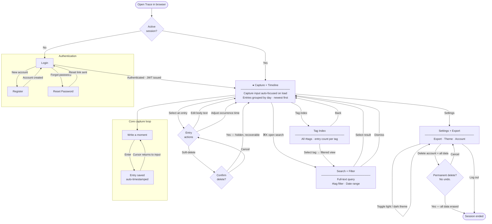
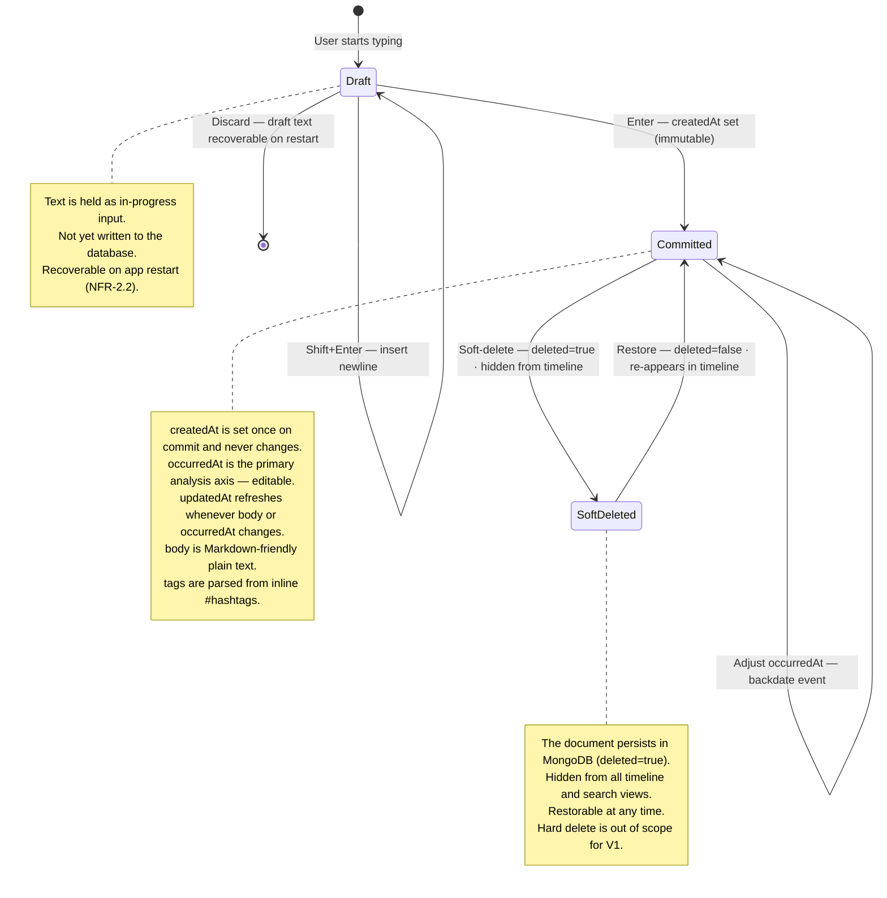
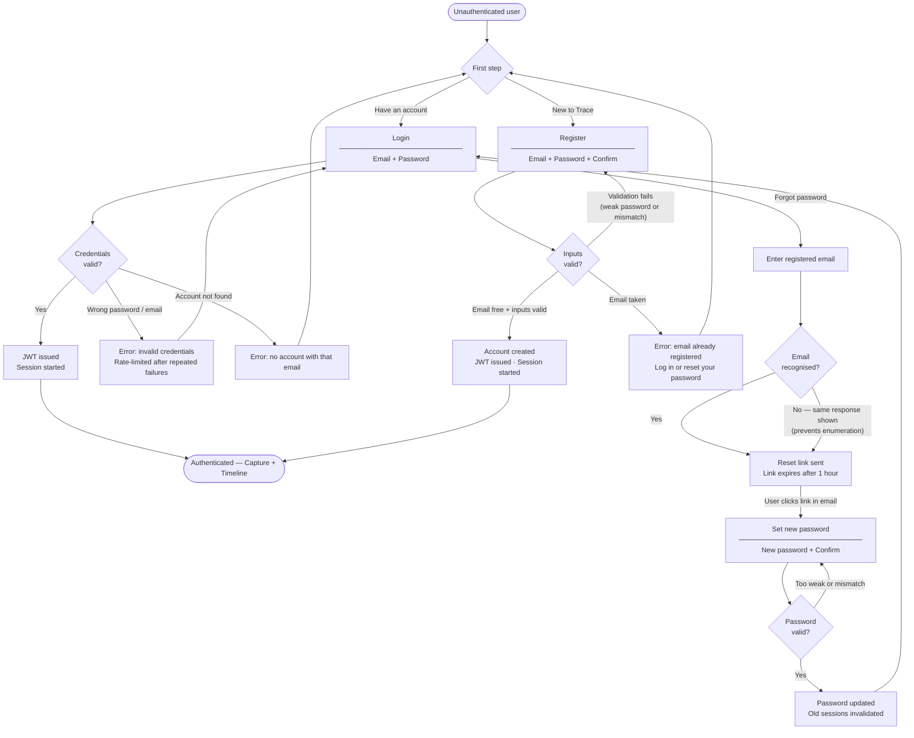

# Trace — V1 Flow Diagrams

**Product:** Trace · personal life-logging web application  
**Version:** V1 · multi-user · hosted MERN  
**Spec reference:** `V1-Requirements-Specification.md` v0.2  
**Diagrams in this document:** 3  

---

## How to use these diagrams

| Audience | Primary diagrams |
|---|---|
| Design (wireframing) | Diagram 1 — User Flow, Diagram 3 — Auth Sub-Flow |
| Development (implementation) | Diagram 2 — Entry Lifecycle, Diagram 3 — Auth Sub-Flow |
| Spec validation | All three — cross-check against FR and NFR IDs |

**Rendering:** every diagram in this file is a fenced Mermaid code block. It renders natively on GitHub, in VS Code with the Mermaid Preview extension, and at [mermaid.live](https://mermaid.live). The standalone `.mermaid` files in this directory can be imported directly into Figma plugins that support Mermaid.

---

## Shape legend

| Shape | Meaning |
|---|---|
| `([text])` | Start / end (stadium) |
| `[text]` | Screen or action |
| `{text}` | Decision / branch |
| Subgraph box | Logical zone grouping related steps |
| State oval | State (stateDiagram-v2) |
| `[*]` | Entry / exit point (stateDiagram-v2) |

---

## Diagram 1 — User Flow

**What it shows:** every user journey through the app, from first browser request to session end. Use this when designing wireframes to ensure every screen has a path in and a path out, and that the capture loop is visually central.

**Key design decisions encoded here:**
- The capture loop is the product's heartbeat — it is separate from but always reachable from the core screen.
- Search is triggered by ⌘K, keeping the surface keyboard-first (NFR-7.1).
- Soft-delete always requires confirmation before proceeding.
- Account deletion is a two-step, irreversible action with a separate confirm screen.

**Spec coverage check**

| Requirement | Covered by |
|---|---|
| FR-1.1 Input auto-focused on load | `HOME` node label |
| FR-1.2 Automatic timestamping | `COMMIT` node |
| FR-1.3 Keyboard commit (Enter) | `TYPE → COMMIT` edge label |
| FR-2.2 Soft delete | `EACT → SDCFM → HOME` path |
| FR-3.1/3.2 Timeline, day groups | `HOME` node label |
| FR-4.1 Full-text search | `SEARCH` node |
| FR-4.2/4.3 Tag + date filter | `SEARCH` node |
| FR-5.1/5.2 Tag index | `TAGIDX` node |
| FR-6.1/6.2 Export MD + JSON | `SETT` self-loop |
| FR-7.1/7.2/7.3 Auth flows | `AUTHZONE` subgraph |
| FR-7.6 Account deletion | `SETT → DELCFM → END` path |
| NFR-7.1 Keyboard-first | ⌘K label on search edge |

---

## Diagram 2 — Entry Lifecycle

**What it shows:** the complete state machine for a single Entry document — from the moment a user starts typing through all possible mutations and deletion states. Use this when implementing the backend model and when designing the inline entry interaction patterns in the wireframes.

**Key design decisions encoded here:**
- `createdAt` is set exactly once at commit and is never mutable — this is the immutable ledger principle from the spec (FR-2.3).
- `occurredAt` is separately editable at any time, enabling backdating (FR-1.5).
- Soft-delete is reversible; there is no hard delete in V1 (FR-2.2, NFR-2.3).
- Draft text lives only on the client until Enter is pressed; it is recoverable on restart (NFR-2.2).

**MongoDB schema alignment**

| State | `deleted` | `createdAt` | `occurredAt` | `updatedAt` |
|---|---|---|---|---|
| Draft | — (not in DB) | — | — | — |
| Committed | `false` | Set once, immutable | Editable | Refreshed on edit |
| SoftDeleted | `true` | Unchanged | Unchanged | Set at soft-delete |

---

## Diagram 3 — Authentication Sub-Flow

**What it shows:** the detailed paths through the authentication system — login, registration, and password reset — including all error branches. Use this when designing the auth screens in the wireframes and when implementing the auth endpoints.

**Key design decisions encoded here:**
- Password reset email response is the same regardless of whether the email is registered, preventing account enumeration attacks (NFR-4.4).
- Rate limiting on login attempts is noted on the error node (NFR-4.5).
- Registration immediately issues a JWT — no separate email verification step in V1.
- Old sessions are invalidated when a password is reset.

**Spec coverage check**

| Requirement | Covered by |
|---|---|
| FR-7.1 Registration | `REGFORM → REGVAL → REGDONE` path |
| FR-7.2 Authentication required | `UNAUTH` start node, JWT gates |
| FR-7.3 Session management + logout | JWT issue on success nodes |
| FR-7.5 Credential recovery | `LOGINFORM → RESETREQ → RESETLINK → NEWPWFORM` |
| NFR-4.1 HTTPS/TLS | Implied; enforced at infrastructure level |
| NFR-4.2 Salted password hash | Implied; enforced at implementation level |
| NFR-4.4 No account enumeration | `RESENTSENT` — same response regardless |
| NFR-4.5 Rate limiting | `LOGINERR` node label |

---

## Deferred diagrams (V2+)

These diagrams are explicitly out of scope for V1 but should be created before building those features:

| Diagram | Trigger |
|---|---|
| Analysis + insights flow | When the pattern engine is added |
| Multi-device sync flow | When offline/sync is implemented |
| Admin / operator flow | When operator controls are needed |
| Data export + re-import flow | If FR-6.4 (import) is promoted to Must |

---

*Source files: `trace-user-flow.mermaid` · `trace-entry-lifecycle.mermaid` · `trace-auth-flow.mermaid`*
