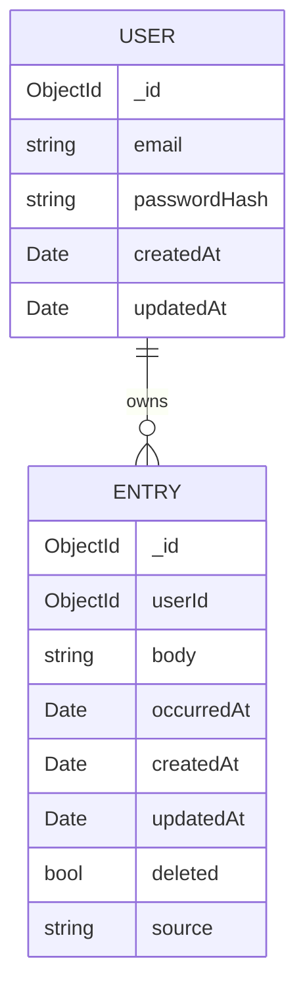

# Phase 1 Data Model: Foundation & Core Capture Loop

This is the feature-scoped view of the data model. The canonical, project-wide
reference is `docs/02-architecture/data-model.md`; this file must stay
consistent with it.

---

## Entities

### User

An authenticated account holder who owns a private, isolated corpus.

| Field | Type | Constraints | Notes |
|---|---|---|---|
| `_id` | ObjectId | PK | Unique user identifier |
| `email` | string | required, unique, lowercased | Login identifier |
| `passwordHash` | string | required | bcrypt salted hash: never plaintext (Constitution V) |
| `createdAt` | Date (UTC) | auto | Account creation instant |
| `updatedAt` | Date (UTC) | auto | Last account update |

**Indexes**: unique index on `email`.

**Invariants**:
- `email` is unique and case-insensitive.
- `passwordHash` is never returned by any API response.

---

### Entry

A single timestamped moment, owned by exactly one user.

| Field | Type | Constraints | Notes |
|---|---|---|---|
| `_id` | ObjectId | PK | Unique entry identifier |
| `userId` | ObjectId | required, FK → User, indexed | Owning user; every query filters on this |
| `body` | string | required, non-empty (trimmed) | Markdown-friendly plain text |
| `occurredAt` | Date (UTC) | required, indexed | When the moment happened: **primary analysis axis**, editable (backdating) |
| `createdAt` | Date (UTC) | required, immutable | Commit instant: set once, never changes (Constitution II) |
| `updatedAt` | Date (UTC) | auto | Refreshes on body or `occurredAt` change |
| `deleted` | boolean | default `false` | Soft-delete flag; hidden when `true` (no hard delete in V1) |
| `source` | string | default `"manual"` | Reserved for future capture methods (e.g. `"voice"`); unused in V1 |

**Indexes**:
- Compound `{ userId: 1, occurredAt: -1, _id: -1 }`: serves the reverse-chronological, day-grouped, cursor-paginated timeline.
- (Reserved for feature 002) `{ userId: 1, tags: 1 }` once tags exist.

**Invariants**:
- `createdAt` is immutable after creation (enforced in the service layer; never accepted from client input).
- All reads exclude `deleted: true` unless explicitly restoring.
- Every read/write is scoped by `userId` (Constitution V; FR-040).

---

## Relationships

## State (Entry lifecycle)

The Entry state machine is documented in
`docs/diagrams/trace-entry-lifecycle.mermaid`:
`Draft → Committed ↔ SoftDeleted` with `createdAt` immutable and no hard delete.

## Field-level mutation rules

| Field | On create | On edit | On backdate | On soft-delete | On restore |
|---|---|---|---|---|---|
| `body` | set | mutable | — | — | — |
| `occurredAt` | = now | — | mutable | — | — |
| `createdAt` | set once | immutable | immutable | immutable | immutable |
| `updatedAt` | = now | refreshed | refreshed | refreshed | refreshed |
| `deleted` | `false` | — | — | `true` | `false` |
